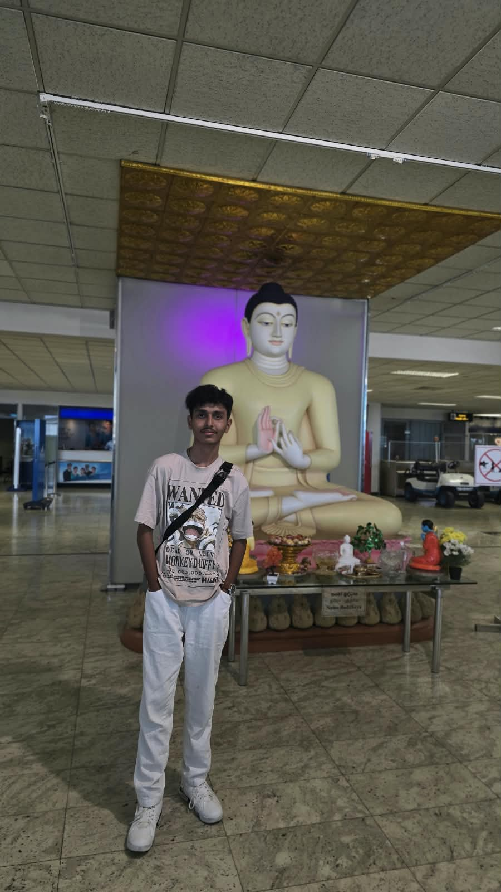

<table width="100%" border="0" cellspacing="0" cellpadding="0">
<tr>
<td valign="middle">

</td>
<td valign="middle" width="192" align="right">

</td>
</tr>
</table>

<br/>

<p>

&nbsp;

&nbsp;

&nbsp;
<a href="https://www.linkedin.com/in/sarveshp2905/">

</a>
&nbsp;
<a href="https://leetcode.com/u/pjEYb7w7lC">

</a>
</p>

---

Final-year B.Tech IT student at Dr. N.G.P Institute of Technology, Coimbatore (CGPA 8.31). I build production-grade full-stack applications, AI-powered tools, and SaaS products. Currently working remotely with **Bright Pathways PTE LTD, Singapore** — AI workspace systems, knowledge infrastructure, and automation pipelines.

Three companies. Real production codebases. Shipped.

---

### Experience

**Software Developer (Remote)** &nbsp;&nbsp; Bright Pathways PTE LTD, Singapore &nbsp;&nbsp; `Sep 2026 — Present`  
AI collaborative workspace · Knowledge vault · Task automation systems · Internal tooling

**React Developer Intern** &nbsp;&nbsp; CIRCOR Flow Technologies (MNC), Coimbatore &nbsp;&nbsp; `Mar 2026 — Jul 2026`  
Enterprise Q2P application migration — legacy Flask/Jinja to React · Node.js REST APIs · MariaDB

**MERN Stack Developer Intern** &nbsp;&nbsp; App Innovation Technologies, Coimbatore &nbsp;&nbsp; `Jun 2025`  
E-commerce platform modernization · Reusable React components · MongoDB Atlas · REST APIs

---

### Projects

| Project | Stack | What it does |
|---|---|---|
| [**Credence**](https://github.com/Sarvesh2905/Credence) — AI Career Re-entry Platform | React · Node · MongoDB · Gemini · Groq · OpenRouter | LLM-powered career assessment, resume analysis, skill analytics — won CodeZap 2026, earned Singapore innovation visit |
| **KatoPulse** — URL Shortener SaaS | React · Vite · Node · MongoDB · Recharts | Real-time device/geo analytics, QR generation, link health scoring, CSV/PDF reports |
| **Brain Stroke Detection** | Python · TensorFlow · VGG19 · EfficientNetB4 | Ensemble deep learning — 95% accuracy across 4,900 MRI/CT scans |
| [**PAMS**](https://github.com/Sarvesh2905/pams-placement-management-system) — Placement Management System | MERN · JWT · bcrypt · Helmet | Full placement workflow platform with hardened auth and rate limiting |
| **Smart Street Lighting** — IISF IIT Guwahati | Arduino · ESP8266 · IR sensors | IoT adaptive brightness system — presented as Finalist at India International Science Festival |

---

### GitHub

<div>

&nbsp;&nbsp;

</div>

<br/>


---

### Stack

**Languages** &nbsp;&nbsp;&nbsp;&nbsp;&nbsp; 

**Frontend** &nbsp;&nbsp;&nbsp;&nbsp;&nbsp;&nbsp;&nbsp; 

**Backend** &nbsp;&nbsp;&nbsp;&nbsp;&nbsp;&nbsp;&nbsp;&nbsp; 

**Databases** &nbsp;&nbsp;&nbsp;&nbsp;&nbsp; 

**Cloud / DevOps** &nbsp; 

**AI / LLM Ecosystem**

```
OpenAI  ·  Gemini  ·  Groq  ·  OpenRouter  ·  Pinecone (Vector DB)  ·  Neo4j  ·  n8n
LLM Orchestration  ·  AI Workflow Design  ·  Autonomous Systems  ·  Prompt Engineering
```

**Tools**

```
VS Code  ·  Postman  ·  GitHub  ·  Vercel  ·  Render  ·  Netlify
Claude  ·  ChatGPT  ·  Gemini  ·  Perplexity  ·  DeepSeek  ·  Qwen
```

---

### Achievements

- **CodeZap 2026 Winner** (Team Silver) — Credence platform — awarded international innovation visit to Singapore
- **IISF IIT Guwahati 2024 Finalist** — Ideas for Vikshit Bharat S&T Hackathon · Smart Street Lighting System
- **Cipher Hunt Winner** — Sri Eshwar THIRAN 2026
- **5th Place, Paper Presentation** — Sri Eshwar THIRAN 2026
- **NPTEL Elite** — Human Computer Interaction; Industry 4.0 & IIoT
- **Certified** — AI Fluency: Framework & Foundations (Anthropic) · GenAI for Front-End Developers (Coursera) · Learnathon 2024 (ICT Academy)

---

<div align="center">

<a href="https://www.linkedin.com/in/sarveshp2905/">

</a>
&nbsp;
<a href="mailto:psarvesh29052006@gmail.com">

</a>

</div>

<br/>

<div align="center">
<sub>B.Tech Information Technology &nbsp;·&nbsp; Dr. N.G.P Institute of Technology, Coimbatore &nbsp;·&nbsp; 2023–2027 &nbsp;·&nbsp; CGPA 8.31</sub>
</div>
