<div align="center">

### `sarvesh@github ~ $ ./contributions.sh`



<br><br>

### `sarvesh@github ~ $ whoami`

<table>
<tr>
<td valign="top"></td>
<td valign="top"></td>
</tr>
</table>

<br><br>

### `sarvesh@github ~ $ ./connect.sh`

**Full-Stack Developer · AI Builder · B.Tech IT '27**

[](https://www.linkedin.com/in/sarveshp2905/)
[](https://leetcode.com/u/pjEYb7w7lC)
[](mailto:psarvesh29052006@gmail.com)

</div>

---

### `~/about $ cat README.txt`

Final-year B.Tech IT student at Dr. N.G.P Institute of Technology, Coimbatore (CGPA 8.31). I build production-grade full-stack applications, AI-powered tools, and SaaS products. Currently working remotely with **Bright Pathways PTE LTD, Singapore** on AI workspace systems, knowledge infrastructure, and automation pipelines.

> Three companies. Real production codebases. Shipped.

### `~/experience $ git log --oneline`

**Software Developer (Remote)** · Bright Pathways PTE LTD, Singapore · `Sep 2026 — Present`<br>
AI collaborative workspace · Knowledge vault · Task automation · Internal tooling

**React Developer Intern** · CIRCOR Flow Technologies, Coimbatore · `Mar 2026 — Jul 2026`<br>
Enterprise Q2P migration · Flask/Jinja to React · Node.js APIs · MariaDB

**MERN Stack Developer Intern** · App Innovation Technologies, Coimbatore · `Jun 2025`<br>
E-commerce modernization · Reusable React components · MongoDB Atlas · REST APIs

### `~/projects $ ls -la featured/`

| Project | Stack | Highlight |
|---|---|---|
| [**Credence**](https://github.com/Sarvesh2905/Credence) | React · Node · MongoDB · Gemini · Groq | AI career re-entry platform · CodeZap 2026 winner |
| **KatoPulse** | React · Vite · Node · MongoDB · Recharts | URL shortener SaaS with live analytics and reporting |
| **Brain Stroke Detection** | Python · TensorFlow · VGG19 · EfficientNetB4 | Ensemble model with 95% accuracy across 4,900 scans |
| [**PAMS**](https://github.com/Sarvesh2905/pams-placement-management-system) | MERN · JWT · bcrypt · Helmet | Secure end-to-end placement workflow platform |
| **Smart Street Lighting** | Arduino · ESP8266 · IR | IISF IIT Guwahati finalist project |

### `~/stack $ ./print-stack.sh`

<p align="center">
  
</p>

```text
AI / LLM     OpenAI · Gemini · Groq · OpenRouter · Pinecone · Neo4j · n8n
Focus        LLM orchestration · AI workflows · autonomous systems · prompt engineering
Tools        GitHub · VS Code · Postman · Vercel · Render · Netlify
```

### `~/achievements $ cat highlights.log`

- **CodeZap 2026 Winner (Team Silver)** — Credence; awarded an international innovation visit to Singapore
- **IISF IIT Guwahati 2024 Finalist** — Ideas for Vikshit Bharat S&T Hackathon
- **Cipher Hunt Winner** and **5th Place, Paper Presentation** — Sri Eshwar THIRAN 2026
- **NPTEL Elite** — Human Computer Interaction; Industry 4.0 & IIoT
- **Certified** — Anthropic AI Fluency · Coursera GenAI for Front-End Developers · ICT Academy Learnathon

<div align="center">
<sub>Built with Python-generated SVGs · contribution art refreshes daily via GitHub Actions</sub>
</div>
